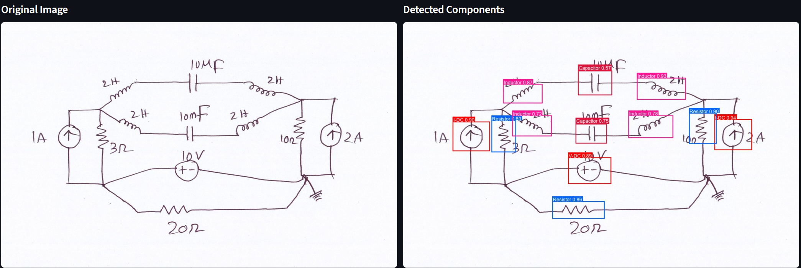

# ⚡ Electronic Schematic Symbol Classifier


Detect and label components in **hand-drawn circuit schematics** with a YOLOv8 Nano model served through a Streamlit web app.

**[▶ Try the live demo](https://ai4all-electronic-schematics.streamlit.app/)** · **[Project page](docs/index.md)**

<p align="center">
  
</p>

## Overview

Hand-drawn schematics are quick to sketch but slow to digitize. This project trains a lightweight object detector that finds and classifies 17 kinds of circuit symbols in photos or scans of paper sketches, as a first step toward converting them into simulation-ready circuits.

| Metric (validation set) | Score |
| --- | --- |
| mAP@50 | **98.8%** |
| mAP@50-95 | **76.1%** |
| Precision | **97.5%** |
| Recall | **97.5%** |

## Detected Classes

The model recognizes 17 symbol classes:

| Sources | Passives | Semiconductors | Other |
| --- | --- | --- | --- |
| V-AC | Resistor | Diode | GND |
| V-DC | Capacitor | Zener Diode | Op-Amp |
| V-DC (one port) | Inductor | BJT-NPN | Wire Crossover |
| I-AC | | BJT-PNP | |
| I-DC | | MOSFET-N | |
| | | MOSFET-P | |

## Features

- **Upload or pick a sample.** Run detection on your own schematic photo or on one of the bundled samples.
- **Live threshold tuning.** Adjust confidence and overlap (IoU) sliders and see the results update instantly. The model only runs once per image.
- **Phone-friendly.** Photo rotation stored in EXIF data is handled automatically.
- **Exportable results.** Download the annotated image as PNG or the detections (class, score, bounding box) as JSON.
- **Lightweight inference.** Uses ONNX Runtime directly, with no PyTorch or Ultralytics needed at runtime.

## Dataset

Trained on **[Digitize-HCD](https://doi.org/10.1016/j.dib.2025.111315)**: 1,277 high-resolution (600 DPI) images of hand-drawn schematics by many different volunteers, annotated in COCO format and converted to YOLO format by the training notebook.

The images are not stored in this repository. They are available on [Google Drive](https://drive.google.com/drive/folders/1SP_MCMQp9Xx-UF4tJfMENyKnxK3ULvwP?usp=share_link).

## Getting Started

**1. Clone the repository**

```bash
git clone https://github.com/anything70/AI4ALL.git
cd AI4ALL
```

**2. Create a virtual environment and install dependencies**

```bash
python -m venv .venv
source .venv/bin/activate        # Windows: .venv\Scripts\activate
pip install -r requirements.txt
```

**3. Run the app**

```bash
streamlit run app/app.py
```

Then open the URL shown in your terminal (usually <http://localhost:8501>).

> **Tip:** Quote version specifiers when installing packages by hand, e.g. `pip install "streamlit>=1.50"`. Without the quotes, the shell treats `>` as a redirect and creates stray files.

You can also open the repo in **GitHub Codespaces**. The dev container installs dependencies and starts the app automatically.

## Project Structure

```text
.
├── app/
│   ├── app.py              # Streamlit web application
│   ├── classes.yaml        # Class display colors (and fallback class names)
│   └── samples/            # Sample schematics selectable in the app
├── models/
│   └── best.onnx           # Exported YOLOv8 Nano weights
├── notebooks/
│   └── YOLOv8_Schematic_Component_Detector_Training_and_Export.ipynb
│                           # Data pipeline, training, evaluation and ONNX export (Colab)
├── docs/                   # GitHub Pages project site
├── .devcontainer/          # Codespaces / dev container config
├── requirements.txt        # Runtime dependencies
└── Procfile                # Deployment entry point
```

## Retraining the Model

Open the notebook in Google Colab with a GPU runtime and run it top to bottom. It downloads the dataset, converts the annotations, trains YOLOv8n and exports `best.onnx`. Replace `models/best.onnx` with the new file. The app reads class names and input size from the model's embedded metadata, so no code changes are needed unless the classes change. If they do, add colors for the new classes in `app/classes.yaml`.

## Authors

Built as part of the AI4ALL program by:

- Jonathan Hahn
- Samantha Dominguez-Flores
- Dikshant Aryal
- Youssef Shaaban

## Citation

> N. Ahmed, M.F. Adnan, A. Shafiullah, H.J. Parash, Md.S. Rahman, I.C. Akib, G. Sarowar, "Digitize-HCD: A dataset for digitization of handwritten circuit diagrams," *Data in Brief*, vol. 59, p. 111315, Apr. 2025. [doi:10.1016/j.dib.2025.111315](https://doi.org/10.1016/j.dib.2025.111315)
